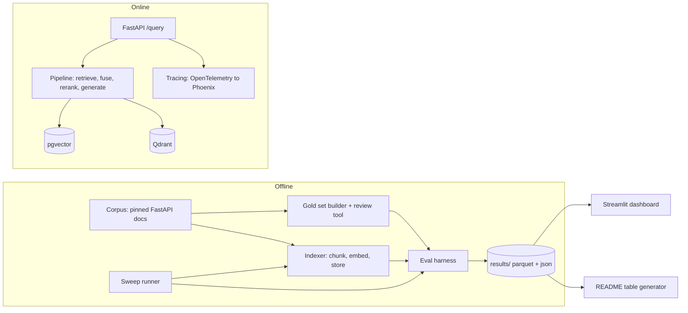

# RAGBench: Agent Build Spec

> Hand this file to a coding agent. It describes what to build, in what order, how to verify each step, and where the agent must stop and ask the human. Read the whole file before writing code.

---

## 0. Working rules for the agent

1. **Work in phases (Section 6).** After each phase, stop at the checkpoint, print a short summary (what was built, how to verify, any deviations), and wait for the human to say "continue". Do not start the next phase on your own.
2. **Never invent results.** Every number that appears in the README, dashboard or resume bullets must be generated by code from files in `results/`. If a run has not happened, write "not yet run". Placeholders look like `[X]`; never fill them with guesses.
3. **Verify library APIs against current documentation before coding against them.** `ragas`, `qdrant-client`, `sentence-transformers`, `arize-phoenix`, `fastembed` and `pgvector` change often. Pin versions in `pyproject.toml` at build time and note the resolved versions in `docs/METHODOLOGY.md`.
4. **Reproducibility first.** Fixed random seeds, pinned corpus commit, pinned model revisions, recorded hardware. A stranger must be able to rerun and get the same numbers within noise.
5. **Small commits, clear messages.** One logical change per commit, conventional-commit style (`feat:`, `fix:`, `docs:`, `test:`, `ci:`).
6. **Tests and lint must pass before each checkpoint.** `make lint test` is green or you do not stop at the checkpoint.
7. **Ask the human only at marked checkpoints or when blocked.** Mark blocked items in `docs/OPEN_QUESTIONS.md` and continue with other work where possible.
8. **Do not commit secrets, large model files, or raw embedding caches.** Use `.gitignore` and `.env.example`.
9. **Be honest in docs.** Document limitations (judge-model bias, synthetic questions, one corpus, one hardware profile) in `docs/LIMITATIONS.md`.

---

## 1. Project goal

Build **RAGBench**, a config-driven platform that benchmarks Retrieval-Augmented Generation pipelines on a fixed corpus, with a verified gold question set. It compares chunking strategies, embedding models, retrieval modes (dense, BM25, hybrid with RRF), rerankers, and two vector backends (pgvector and Qdrant). It reports retrieval quality, generation quality, latency and resource cost, with confidence intervals.

The repository is a portfolio piece for an AI/ML engineering job search. It must read as shipped engineering, not a notebook dump:

- A reproducible CLI and sweep runner
- A FastAPI service exposing any configuration
- Tracing
- CI that fails on retrieval regressions
- A public dashboard
- A README that leads with findings

### Success criteria (definition of done)

- [ ] `make reproduce` reruns the full pipeline from a clean clone and regenerates `results/` and the README results table
- [ ] Gold set: at least 150 human-verified questions with section-level relevance spans, split into dev and test
- [ ] At least 3 chunkers, 3 embedders, 3 retrieval modes (dense, BM25, hybrid-RRF), 2 rerank options (none, cross-encoder), 2 backends evaluated in a staged sweep
- [ ] Metrics: Recall@{1,3,5,10}, MRR@10, nDCG@10 with bootstrap 95% CIs; p50/p95 latency per stage; indexing time; index size; RAGAS generation metrics on the top configs
- [ ] FastAPI service with `/health`, `/configs`, `/query` and OpenAPI docs; runs via `docker compose up`
- [ ] GitHub Actions: lint, unit tests, and a small regression eval that fails if Recall@5 drops more than the threshold
- [ ] Streamlit dashboard (replay mode) deployable to a free host, with leaderboard, Pareto plot, ablation view and query explorer
- [ ] README findings section is auto-generated from `results/`, with methodology, limitations and architecture diagram
- [ ] MIT license, contributing note, and a short demo storyboard

---

## 2. Decisions already made by the human

| Topic | Decision |
|---|---|
| Corpus | Public framework docs. Use the **FastAPI documentation** (English markdown under `docs/en/docs` in the `fastapi/fastapi` GitHub repo), pinned to a specific release tag or commit SHA recorded in `corpus.lock`. Confirm the repository license permits reuse and record it. If the docs layout has changed, inspect the repo and adapt; if FastAPI docs are unusable, fall back to another permissively licensed framework's docs and log the change in `docs/OPEN_QUESTIONS.md`. |
| Models | **Free and local first.** Open embedding models via `sentence-transformers`, an open cross-encoder reranker, and a local LLM served by Ollama for generation and judging. All LLM calls go through an **OpenAI-compatible client** configured by env vars (`LLM_BASE_URL`, `LLM_API_KEY`, `LLM_MODEL`), so a free-tier hosted API can be swapped in without code changes. |
| Dashboard | **Streamlit**, deployed on Hugging Face Spaces or Streamlit Community Cloud. Hosted mode is **replay mode** (reads stored results; no live inference). Live mode works locally against the docker-compose stack. |
| Agent style | **Phased with checkpoints.** |

Unknown at start: the human's hardware (CPU only vs GPU). In Phase 0, detect hardware and choose model sizes accordingly (see Section 5.5). Record the hardware in `results/hardware.json`.

---

## 3. Architecture



### Repository layout

```
ragbench/
├── README.md                    # findings-first; results table auto-generated
├── LICENSE                      # MIT
├── pyproject.toml               # uv-managed, pinned
├── Makefile
├── docker-compose.yml           # postgres+pgvector, qdrant, api, optional phoenix
├── Dockerfile.api
├── Dockerfile.dashboard
├── .env.example
├── corpus.lock                  # repo URL, tag/SHA, license, fetch date, file count
├── configs/
│   ├── pipeline.example.yaml
│   └── grid.yaml                # staged sweep definition
├── data/                        # gitignored except small fixtures
│   ├── raw/                     # downloaded docs
│   ├── documents.jsonl
│   └── goldset/
│       ├── candidates.jsonl
│       ├── verified.jsonl       # committed
│       └── splits.json          # dev/test question ids, committed
├── src/ragbench/
│   ├── cli.py                   # typer app
│   ├── config.py                # pydantic models
│   ├── corpus/                  # fetch, clean, parse sections
│   ├── goldset/                 # generate, filter, review UI, split
│   ├── chunking/                # fixed, recursive_md, semantic
│   ├── embedding/               # sentence-transformers wrapper + disk cache
│   ├── stores/                  # pgvector_store.py, qdrant_store.py, base.py
│   ├── retrieval/               # dense, sparse, hybrid_rrf, control_bm25
│   ├── rerank/                  # none, cross_encoder
│   ├── generation/              # prompt, llm client
│   ├── eval/                    # retrieval_metrics, ragas_runner, stats, latency
│   ├── sweep/                   # staged grid runner with caching and resume
│   ├── api/                     # fastapi app, schemas, pipeline cache
│   ├── tracing/                 # otel setup
│   └── report/                  # README table + figures generator
├── dashboard/
│   ├── app.py
│   └── pages/
├── results/                     # committed: summary.csv, per-run json; large parquet via release asset
├── tests/
│   ├── unit/
│   ├── integration/             # needs docker services; marked
│   └── fixtures/mini_corpus/    # ~30 docs + ~40 questions for CI
├── eval/baseline.json           # CI regression baseline
├── docs/
│   ├── METHODOLOGY.md
│   ├── LIMITATIONS.md
│   ├── OPEN_QUESTIONS.md
│   ├── DEMO_STORYBOARD.md
│   └── architecture.md
└── .github/workflows/ci.yml
```

---

## 4. Core interfaces (implement exactly this shape)

```python
# src/ragbench/types.py
from dataclasses import dataclass
from typing import Protocol, Sequence

@dataclass(frozen=True)
class Document:
    doc_id: str            # stable, e.g. relative path
    title: str
    text: str              # cleaned markdown
    sections: list["Section"]

@dataclass(frozen=True)
class Section:
    section_id: str        # f"{doc_id}#{slug}"
    heading_path: str
    start: int             # char offsets in Document.text
    end: int

@dataclass(frozen=True)
class Chunk:
    chunk_id: str          # hash of (doc_id, start, end, chunker_config)
    doc_id: str
    start: int
    end: int
    text: str

@dataclass(frozen=True)
class Hit:
    chunk: Chunk
    score: float
    source: str            # "dense" | "sparse" | "fused" | "reranked"

class Chunker(Protocol):
    def chunk(self, doc: Document) -> list[Chunk]: ...

class Embedder(Protocol):
    name: str
    dim: int
    def embed_documents(self, texts: Sequence[str]) -> "np.ndarray": ...
    def embed_query(self, text: str) -> "np.ndarray": ...

class Store(Protocol):
    def reset(self, namespace: str, dim: int) -> None: ...
    def add(self, namespace: str, chunks: Sequence[Chunk], vectors: "np.ndarray") -> None: ...
    def dense_search(self, namespace: str, qvec: "np.ndarray", k: int) -> list[Hit]: ...
    def sparse_search(self, namespace: str, query: str, k: int) -> list[Hit]: ...
    def size_bytes(self, namespace: str) -> int: ...

class Reranker(Protocol):
    def rerank(self, query: str, hits: Sequence[Hit], k: int) -> list[Hit]: ...
```

Design rules:

- **Fusion (RRF, k=60) and reranking happen in application code, not inside the databases**, so both backends are compared with identical fusion logic. Each backend only supplies dense search and sparse (lexical) search.
- Embedders apply the correct query/passage prefixes for each model family (for example `bge` uses a query instruction; `e5` uses `query: ` and `passage: `). Verify against each model card.
- Cache embeddings on disk keyed by `(model_name, model_revision, sha256(text))`.

---

## 5. Technical specification

### 5.1 Configuration

Pipelines are defined in YAML and validated with pydantic. A `config_id` is a short hash of the normalized config.

```yaml
# configs/pipeline.example.yaml
corpus: fastapi_docs
chunker: {type: recursive_md, size_tokens: 512, overlap_tokens: 64}
embedder: {name: BAAI/bge-small-en-v1.5}
backend: pgvector            # pgvector | qdrant
retrieval:
  mode: hybrid               # dense | sparse | hybrid
  k_dense: 50
  k_sparse: 50
  rrf_k: 60
rerank: {type: cross_encoder, model: BAAI/bge-reranker-base, top_n: 50}
final_k: 10
generation: {enabled: true, context_k: 5, temperature: 0.0}
seed: 42
```

### 5.2 Chunkers

1. `fixed`: token windows with overlap, sizes {256, 512}.
2. `recursive_md`: Markdown-header-aware recursive splitter that keeps heading path in chunk metadata, sizes {256, 512}.
3. `semantic`: sentence-embedding similarity breakpoints with min and max chunk size bounds (threshold configurable).

Every chunk records `(doc_id, start, end)` character offsets into the cleaned document text. This is required for span-overlap scoring.

### 5.3 Stores

**pgvector** (image `pgvector/pgvector`, a recent Postgres major version):

- `CREATE EXTENSION vector;`
- Dense: HNSW index with cosine ops, `m=16`, `ef_construction=64`; set `hnsw.ef_search=100` at query time.
- Sparse: Postgres full-text search (`tsvector` with GIN index), ranked with `ts_rank_cd`; query via `websearch_to_tsquery` or `plainto_tsquery`.

**Qdrant**:

- Dense: HNSW, cosine, `m=16`, `ef_construct=64`, search `hnsw_ef=100`.
- Sparse: Qdrant sparse vectors with a BM25-style sparse encoder (for example the one in `fastembed`; verify in current docs).

**Control:** a backend-agnostic in-process BM25 (`bm25s` or `rank_bm25`) as `control_bm25`. The two backends' lexical scoring differs, so this control separates "backend effect" from "lexical-scorer effect". Document this in METHODOLOGY.

Keep HNSW parameters equal across backends and state that in the methodology. Report exact-search recall (brute-force) once as a sanity check of the ANN indexes.

### 5.4 Rerankers

- `none`
- `cross_encoder`: `BAAI/bge-reranker-base` through `sentence-transformers` `CrossEncoder`. Rerank the top `top_n` fused candidates down to `final_k`.
- Optional stretch: a second, smaller cross-encoder (for example an MS MARCO MiniLM variant) to show the quality/latency trade-off.

### 5.5 Models and hardware

At Phase 0, detect CPU/GPU, RAM, and Ollama availability; write `results/hardware.json`.

- **Embedders (3):** `BAAI/bge-small-en-v1.5`, `sentence-transformers/all-MiniLM-L6-v2`, `intfloat/e5-small-v2`. Optionally one larger model if hardware allows. Record the exact model revisions.
- **LLM (generation and judge):** via Ollama OpenAI-compatible endpoint.
  - CPU only: a small instruct model in the 1B to 3B range.
  - Consumer GPU: a 7B to 8B instruct model.
  - Choose and record the model; do not silently change it between runs.
- Judge and generator may be the same model; document the self-preference bias risk. If a second model is available, use it for judging.

### 5.6 Gold set (this is the most important part for credibility)

**Chunker-agnostic labels.** Relevance is defined on the *source document sections*, not on chunks. A retrieved chunk is a hit if its `[start, end)` character span overlaps a gold span by at least a minimum fraction (default: any overlap of at least 20% of the chunk or 20% of the gold span; make this configurable and report the setting). This allows fair comparison across chunking strategies.

**Generation pipeline (`ragbench goldset generate`):**

1. Parse documents into sections using headings.
2. Sample sections stratified by document and length; skip sections that are too short or are pure code, tables or changelogs.
3. For each sampled section, prompt the LLM to write one question and a reference answer that is answerable *only* from that section. Question types to cover: factual lookup, how-to/procedural, and "why/when" explanation. Optional stretch: multi-section questions that need two sections (record both gold spans).
4. **Quality filters:**
   - Drop questions that copy the heading text or have very high lexical overlap with the section (this would unfairly favor BM25). Report the overlap threshold used.
   - Drop duplicates by embedding similarity.
   - Answerability check: ask the judge model whether the reference answer is supported by the section text; drop failures.
5. Write `data/goldset/candidates.jsonl` with fields: `qid, question, reference_answer, gold_sections[], gold_spans[], question_type, source_doc, verified: false`.

**Human review (`ragbench goldset review`):** a small Streamlit or terminal tool to accept, edit or reject each candidate, and to flag ambiguous questions. Accepted items go to `verified.jsonl` with `verified: true`.

**Splits:** split verified questions into **dev (30%)** and **test (70%)**, stratified by question type, seeded, saved to `splits.json`. All tuning and config selection happens on dev only; headline numbers are reported on test only.

> **USER ACTION at the end of Phase 1:** the human must review candidates and reach at least 150 verified questions. If the human has not finished, the agent may proceed with provisional results but must (a) mark all outputs "provisional: unverified gold set", and (b) report metrics separately for verified-only and all-synthetic.

### 5.7 Metrics

**Retrieval** (computed per query, aggregated on the test split):

- Recall@{1,3,5,10}: fraction of questions with at least one gold span hit in the top-k
- MRR@10
- nDCG@10 (binary relevance via span overlap; document how multiple chunks hitting the same gold span are handled: count each gold span's first hit only, to avoid inflating scores for fine-grained chunkers)
- Report the mean with a **bootstrap 95% CI** (1000+ resamples over questions, seeded). For config-vs-baseline comparisons, use a **paired bootstrap** on per-question differences.

**Efficiency:**

- Query latency p50 and p95 per stage (embed query, dense, sparse, fusion, rerank, total), measured warm, single request at a time, over the full query set, repeated for at least 3 passes (discard the first as warm-up)
- Indexing time and embedding throughput (chunks/sec)
- Index size on disk per backend
- Peak RAM during indexing where measurable
- Tokens per query (retrieval context plus prompt) for generation runs
- Dollar cost: report only when a priced hosted provider was actually used; local runs report compute time. If you include a hypothetical price table, label it clearly as an assumption.

**Generation** (top configs only, controlled by `--top-n-configs`, default 5, on a fixed subset of 100 test questions):

- RAGAS: faithfulness, answer relevancy, context precision, context recall (check current RAGAS API; metric names and LLM-wrapper setup have changed across versions)
- Judge temperature 0, fixed seed where supported, record judge model and prompt versions
- Manually spot-check 20 judged items and save them in `docs/judge_spotcheck.md` as a sanity audit (the human does the checking; the agent prepares the file with items to check)

### 5.8 Sweep design (do not run a full cartesian product)

Staged search to keep compute reasonable. Select winners on **dev**, then evaluate the finalists on **test**.

- **Stage A: chunking x embedder**, dense retrieval only, pgvector. (3 chunkers x 2 sizes where applicable x 3 embedders)
- **Stage B: retrieval mode**, using the top 3 configs from A: dense, sparse, hybrid-RRF, plus `control_bm25`.
- **Stage C: reranking**, using the top 3 from B: none vs cross-encoder; sweep `top_n` in {20, 50}.
- **Stage D: backend**, using the top 3 from C: pgvector vs Qdrant; compare quality (should match closely) and latency/size.
- **Stage E: generation metrics**, on the top 5 overall.

Runner requirements: `ragbench sweep --grid configs/grid.yaml`, estimates the number of runs before starting, caches embeddings and indexes, resumes after interruption, writes one JSON per run and an appended `results/summary.csv`, and records config, seed, corpus SHA, package versions and hardware in every run.

### 5.9 API

FastAPI app in `src/ragbench/api/`:

- `GET /health`: service and backend connectivity
- `GET /configs`: list of available pipeline configs (from `results/` and `configs/`)
- `POST /query`: body `{question, config_id | config, generate: bool}`; response `{answer?, contexts: [{chunk_id, doc_id, text, score, source}], timings_ms: {...}, trace_id}`
- `GET /eval/summary`: the latest `summary.csv` as JSON

Requirements: pydantic request/response models, pipeline objects cached per `config_id`, clear error messages, input length limits, OpenAPI docs at `/docs`, and tests with `httpx` against the app using the mini fixture.

### 5.10 Tracing

OpenTelemetry spans around each pipeline stage. Default viewer: **Arize Phoenix** (runs as a single local container or process). Tracing must be **off by default** and enabled by `TRACING=1`. Optional: Langfuse export behind a flag. Include one screenshot of a trace in `docs/` (human captures it).

### 5.11 CI (GitHub Actions)

Jobs:

1. **lint-test:** `ruff`, `mypy` (or `pyright`), unit tests (no large models; use tiny stubs).
2. **regression-eval:** runs on pull requests against `tests/fixtures/mini_corpus` (~30 docs, ~40 questions) with a tiny embedding model on CPU, using pgvector and Qdrant as service containers. Compare Recall@5 and MRR@10 to `eval/baseline.json`; **fail if Recall@5 drops by more than 3 points absolute** (threshold in a config file). Cache Hugging Face models between runs. Target under 10 minutes.
3. **docker-build:** build the API and dashboard images.

Document how to update the baseline intentionally (`make update-baseline`) and require the PR description to explain why.

### 5.12 Dashboard (Streamlit, replay mode)

Pages:

1. **Leaderboard:** sortable, filterable table (chunker, embedder, mode, reranker, backend) with Recall@5, MRR@10, nDCG@10 and CIs, p95 latency.
2. **Pareto:** scatter of Recall@5 (y) vs p95 latency (x), colored by retrieval mode, Pareto frontier highlighted. Log scale where it helps. Clicking or selecting a point shows the config.
3. **Ablations:** effect of each factor (chunker, embedder, mode, reranker, backend) with CIs and paired-bootstrap deltas against the baseline.
4. **Query explorer (replay):** pick a gold question and two configs; show retrieved chunks side by side with the gold span highlighted, scores, and stage timings, all read from stored per-query results.
5. **Methodology and limitations:** rendered from `docs/`.

Replay mode needs only files in `results/` (keep per-query retrieval results for test questions small enough to commit or attach as a release asset). Live mode (local only) calls the API. Deploy to Hugging Face Spaces or Streamlit Community Cloud.

> **USER ACTION:** deployment needs the human's account and credentials. The agent writes the deployment files and step-by-step instructions in `docs/DEPLOY.md` but does not attempt to log in.

---

## 6. Phases and checkpoints

### Phase 0: Scaffold and environment

Tasks: repo layout, `uv` project, `ruff`, type checker, `pytest`, pre-commit, `Makefile` (`setup lint test up down ingest goldset sweep report reproduce dashboard update-baseline`), `docker-compose.yml` (pgvector, Qdrant, optional Phoenix), `.env.example`, hardware detection, CI skeleton, MIT license.

**Checkpoint 0:** `make setup lint test` green; `docker compose up -d` brings up pgvector and Qdrant; `results/hardware.json` written. Report the detected hardware and the model sizes you chose.

### Phase 1: Corpus and gold set

Tasks: fetch the pinned docs and write `corpus.lock`; clean markdown and parse sections; produce `documents.jsonl`; implement gold-set generation, filters and the review tool; produce `candidates.jsonl` (target at least 400 candidates so that at least 150 survive review); implement splits.

**Checkpoint 1 (USER ACTION):** show corpus stats (documents, sections, tokens), 10 sample candidates, and the filter drop counts. The human reviews candidates until at least 150 are verified. Do not continue until the human confirms or explicitly says to proceed with provisional data.

### Phase 2: Pipeline components

Tasks: chunkers, embedders with cache, both stores, `control_bm25`, RRF fusion, cross-encoder reranker, config models, a `ragbench query` CLI to run one config on one question end to end, and unit and integration tests (fixture-based).

**Checkpoint 2:** `ragbench query --config configs/pipeline.example.yaml "How do I declare a query parameter?"` returns ranked chunks with scores and stage timings on both backends; tests pass.

### Phase 3: Evaluation harness

Tasks: span-overlap scoring, retrieval metrics with bootstrap CIs, latency profiler, indexing and size measurement, results schema and writer, `ragbench eval --config ... --split dev|test`, exact-search sanity check for ANN indexes.

**Checkpoint 3:** a baseline dense config evaluated on dev, with metrics, CIs and latency printed; unit tests for metrics with hand-computed examples; results JSON written and schema-validated.

### Phase 4: Sweep and generation metrics

Tasks: staged sweep runner with caching and resume; RAGAS runner on top configs; selection on dev and final evaluation on test; `results/summary.csv`; findings summary draft (generated, not hand-written).

**Checkpoint 4:** run counts and total runtime reported; leaderboard printed; top configs listed with CIs; any surprising result flagged with a short hypothesis marked as hypothesis. Human reviews before the README is written.

### Phase 5: API, tracing, CI, dashboard

Tasks: FastAPI app and tests; optional tracing; Dockerfiles and compose services; CI workflows with regression baseline from the mini fixture; Streamlit dashboard; `docs/DEPLOY.md`.

**Checkpoint 5:** `docker compose up` serves the API; a sample `curl` works; CI passes on a PR; a deliberately degraded config (for example chunk size 16) makes the regression job fail (include the evidence in `docs/METHODOLOGY.md`); dashboard runs locally in replay mode. **USER ACTION:** deploy the dashboard using `docs/DEPLOY.md`.

### Phase 6: Docs, polish, release

Tasks: README (Section 8), `METHODOLOGY.md`, `LIMITATIONS.md`, architecture diagram, `make report` regenerating the README results table and figures, `make reproduce`, `DEMO_STORYBOARD.md`, release tag with larger result files attached, resume bullet drafts (Section 9) filled only with real numbers.

**Checkpoint 6 (final):** clean-clone test: clone to a temp directory, run `make setup reproduce` (or the documented fast path on the mini fixture), confirm outputs match committed results within stated noise. **USER ACTION:** record the demo and capture one trace screenshot.

---

## 7. Quality bar and pitfalls to avoid

- **Leakage:** do not tune on test. Do not let gold questions copy heading text. Do not let the judge model see only favorable examples.
- **Unfair comparisons:** same HNSW parameters, same fusion code, same candidate counts; state any asymmetry.
- **Confounds:** change one factor at a time within a stage; report CIs; do not claim a difference whose paired CI includes zero.
- **Overclaiming:** one corpus, one hardware profile, synthetic questions with human verification. Say so in `LIMITATIONS.md`. Never write "state of the art" or similar.
- **Latency measurement:** warm caches, no concurrent jobs, record the CPU/GPU, report p50 and p95, not means only.
- **Scope creep:** the stretch items (multi-section questions, a second reranker, Langfuse export) come last and only if earlier phases are solid.

---

## 8. README outline (auto-generate the numeric parts)

1. One-paragraph pitch and a link to the live dashboard
2. **Key findings**: 4 to 6 bullets, each generated from `results/` with its number and CI (example shape: "Hybrid + cross-encoder rerank raised Recall@5 from `[X]` to `[Y]` (95% CI `[a, b]`) at `[Z]` ms extra p95 latency")
3. Results table (auto-generated between marker comments)
4. Pareto chart image
5. Architecture diagram (mermaid)
6. Quickstart (3 commands) and reproduction instructions with expected runtime and hardware
7. Methodology summary linking `docs/METHODOLOGY.md`
8. Limitations linking `docs/LIMITATIONS.md`
9. Repo tour, API usage example, CI badge, license

---

## 9. Resume and LinkedIn drafts (fill only from real results)

Resume bullet templates (agent writes the final versions after Checkpoint 6, with numbers copied from `results/summary.csv`):

- Built **RAGBench**, a config-driven RAG evaluation platform comparing `[N]` retrieval pipelines (chunking, embeddings, dense/BM25/hybrid, reranking) across pgvector and Qdrant on a `[M]`-question human-verified gold set.
- Found that hybrid retrieval with cross-encoder reranking improved Recall@5 by `[X]` points (95% CI `[a, b]`) at `[Y]` ms added p95 latency; published results through a public Streamlit dashboard.
- Shipped a FastAPI service, Docker Compose stack, OpenTelemetry tracing, and a CI regression gate that fails pull requests when Recall@5 drops more than 3 points.

LinkedIn post outline: the problem (RAG changes are rarely measured), the method (verified gold set, CIs), one surprising finding, link to repo and dashboard.

---

## 10. Final report the agent must produce

At the end, write `docs/FINAL_REPORT.md` containing: what was built, the exact commands to run everything, the resolved package and model versions, hardware used, total compute time, known issues, deviations from this spec with reasons, and the list of remaining human actions (gold-set review, deployment, demo recording, trace screenshot).
