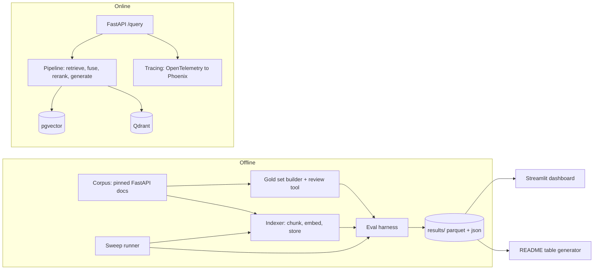

# RAGBench

A config-driven platform for benchmarking Retrieval-Augmented Generation (RAG) pipelines on a fixed, pinned corpus with a **human-verified gold question set**. It compares chunking strategies, embedding models, retrieval modes (dense, BM25, hybrid-RRF), rerankers, and two vector backends (pgvector and Qdrant), and reports retrieval quality, generation quality, latency and cost with confidence intervals.

> **Status: under construction (Phase 4 of 6: retrieval sweep and RAGAS complete, awaiting human review).** The staged sweep (33 configs on dev), the test-split evaluation of the 5 dev-selected finalists, and RAGAS generation metrics on those finalists are done. The API, tracing, CI gate and dashboard come in Phase 5. Every number below is copied from files in `results/`; where a stage has not run, it says so rather than guessing.

## Why this exists

RAG systems are usually tuned on vibes. This project makes the comparison honest:

- **Chunker-agnostic relevance labels.** Gold labels are spans in the *source document sections*, not in chunks. A retrieved chunk counts as a hit if its character span overlaps a gold span by a configurable minimum fraction — so chunking strategies are compared fairly.
- **A verified gold set, not raw LLM output.** Questions are generated by an LLM, then filtered (heading-copy, lexical-overlap, embedding dedup, answerability judge) and finally **reviewed by a human**. At least 150 questions must be human-verified before headline numbers are trusted.
- **Reproducibility first.** Pinned corpus commit, fixed seeds, pinned model revisions, recorded hardware. A stranger can rerun and get the same numbers within noise.

## Architecture



## Quickstart

```bash
# 1. Install (uv-managed, Python 3.13+)
make setup

# 2. Configure your LLM endpoint (any OpenAI-compatible API)
cp .env.example .env
# edit .env: LLM_BASE_URL, LLM_API_KEY, LLM_MODEL

# 3. Verify the endpoint answers
uv run ragbench llm-probe

# 4. Fetch the pinned corpus and build documents.jsonl
make ingest

# 5. Start the vector backends (pgvector + Qdrant)
make up

# 6. Index the corpus with a pipeline config and run a query
make index
ragbench query --config configs/pipeline.example.yaml "How do I declare a query parameter?"

# 7. Evaluate a config on the dev split (indexes in-process, writes results/)
ragbench eval --config configs/baseline_dense.yaml --split dev

# 8. Run the staged sweep on dev (resumable), then evaluate dev-selected finalists on test
ragbench sweep --grid configs/grid.yaml
ragbench finalize --grid configs/grid.yaml --skip-ragas   # drop --skip-ragas for RAGAS
```

> **GPU note.** The lockfile pins CPU torch, so CI and a fresh `make setup` stay CPU-only. To use an NVIDIA GPU locally, install a CUDA build of the same torch into `.venv` (e.g. `uv pip install --no-deps --reinstall-package torch "torch==2.15.0+cu132" --index-url https://download.pytorch.org/whl/cu132`). Then set `UV_NO_SYNC=1` for every `uv run`, `make` target **and `git commit`** (the pre-commit hooks call `uv run`), or uv silently re-syncs the CPU wheel.

### LLM endpoint

All generation and judging go through one OpenAI-compatible client configured by env vars, so you can point it at Ollama, a private proxy, or a hosted API with no code changes:

| Variable | Meaning |
|---|---|
| `LLM_BASE_URL` | OpenAI-compatible base URL (e.g. `http://localhost:11434/v1`) |
| `LLM_API_KEY` | API key (use `ollama` for local Ollama) |
| `LLM_MODEL` | Model id to use for generation + judging |

See `.env.example` for the full list, including Postgres/Qdrant connection strings and the tracing toggle.

## Corpus

The corpus is the **FastAPI documentation** (English markdown under `docs/en/docs`), pinned to a specific release tag and commit SHA in [`corpus.lock`](corpus.lock). The license (MIT) is recorded there too, along with a SHA-256 of the fetched files so a rerun is verifiably the same corpus.

Relevance labels are defined at the **section** level. `ragbench corpus ingest` cleans the markdown, parses it into heading-delimited sections with character offsets, and writes `data/documents.jsonl`.

## Gold set

`ragbench goldset generate` samples sections (stratified by document and length), prompts the LLM for one question + reference answer per section, then applies quality filters:

- **Heading-copy** — drop questions that near-copy the heading.
- **Lexical-overlap** — drop near-verbatim section phrasing (would unfairly favor BM25).
- **Embedding dedup** — drop near-duplicate questions (cosine similarity over an ONNX MiniLM/BGE embedder, no torch required).
- **Answerability judge** — a judge model confirms the reference answer is supported by the section; failures are dropped.

Thresholds and per-stage drop counts are written to `data/goldset/generate_stats.json`. Survivors land in `data/goldset/candidates.jsonl`.

`ragbench goldset review` is a terminal tool (`a`ccept / `e`dit / `r`eject / `f`lag / `q`uit) that writes verified questions to `verified.jsonl`. Accepted questions are split into **dev (30%)** and **test (70%)**, stratified by question type and seeded.

## Pipeline

`ragbench index --config <yaml>` chunks all documents, embeds them, and stores them in the configured backend. `ragbench query --config <yaml> "<question>"` runs the full retrieval pipeline and prints ranked hits with per-stage timings.

Pipeline config controls:

| Field | Options |
|---|---|
| `chunker.type` | `fixed`, `recursive_md`, `semantic` |
| `embedder.name` | any sentence-transformers model (e.g. `BAAI/bge-small-en-v1.5`) |
| `backend` | `pgvector`, `qdrant` |
| `retrieval.mode` | `dense`, `sparse`, `hybrid` (RRF, k=60); `control_bm25` is a backend-agnostic in-process BM25 |
| `rerank.type` | `none`, `cross_encoder` (BAAI/bge-reranker-base) |

See [`configs/pipeline.example.yaml`](configs/pipeline.example.yaml) for the full schema. The `corpus` field selects the dataset: `fastapi_docs` (full corpus + verified gold set) or `mini` (the 30-doc / 40-question CI fixture).

## Evaluation

`ragbench eval --config <yaml> --split dev|test` indexes the config's corpus, runs every split question through the pipeline, and records the run:

- **Relevance:** a retrieved chunk hits a gold span of the same document when the overlap is at least 20% of the chunk **or** 20% of the gold span (`--min-overlap-frac`, default 0.2). Each gold span is credited once, to its first hit, so fine-grained chunkers cannot inflate scores.
- **Metrics:** Recall@{1,3,5,10}, MRR@10, nDCG@10. Each is reported with a seeded 95% percentile-bootstrap CI (1000 resamples over questions). A paired bootstrap is available for config-vs-baseline deltas.
- **Latency:** p50/p95 for each stage (`embed_query, dense, sparse, fusion, rerank, total`). Requests run warm, one at a time, over at least 3 passes, and the first pass is dropped as warm-up. Query embeddings are always computed live, never served from the cache.
- **Indexing:** wall time, embedding throughput, index size on disk, and peak RSS.
- **ANN sanity check:** the HNSW top-k is compared with brute-force cosine search; the agreement is recorded as `ann_sanity_recall` and expected to be ≥ 0.98.
- **Output:** `results/runs/{config_id}__{split}.json` (full config, corpus pin, package versions, metrics + CIs, latencies, per-question ranked hits) plus one row per `(config_id, split)` in `results/summary.csv`. `--update-baseline` also writes `eval/baseline.json` for the CI regression gate.

Full details are in [`docs/METHODOLOGY.md`](docs/METHODOLOGY.md).

## Commands

| Command | What it does |
|---|---|
| `make setup` | Install deps and pre-commit hooks |
| `make lint` | Ruff check + format check + mypy |
| `make test` | Unit tests |
| `make test-integration` | Integration tests (needs `make up`) |
| `make ingest` | Fetch pinned corpus, build `documents.jsonl` |
| `make goldset` | Generate filtered gold-set candidates |
| `make goldset-review` | Interactively review candidates |
| `make up` / `make down` | Start/stop pgvector + Qdrant |
| `make index` | Index corpus with `configs/pipeline.example.yaml` |
| `ragbench eval --config <yaml> --split dev` | Evaluate a config; write run JSON + `summary.csv` row |
| `ragbench sweep --grid configs/grid.yaml [--estimate-only]` | Staged sweep on dev (A chunker x embedder -> B mode -> C rerank -> D backend); resumes and reuses completed runs |
| `ragbench finalize --grid configs/grid.yaml [--skip-ragas]` | Dev-selected finalists -> test runs -> RAGAS -> leaderboard + `results/findings_draft.md` |
| `ragbench leaderboard --split dev\|test` | Print a leaderboard of stored runs |
| `ragbench bench-embed` | Cold (cache-bypassing) embedding throughput per embedder |
| `make sweep` | Run the config sweep |
| `make report` | Generate the results report |
| `make reproduce` | Rerun the full pipeline end-to-end |

## Results

> **Phase 4: retrieval and RAGAS complete.** 33 configs were swept on the **dev** split (47 questions) and ranked by nDCG@10. Only the top 5 were evaluated on the **test** split (110 questions), so test never influenced selection. All runs used the same machine and GPU (RTX 3050 Laptop, `results/hardware.json`). These results await human review (Checkpoint 4). Numbers are copied from `results/runs/*.json`; the generated analysis is in [`results/findings_draft.md`](results/findings_draft.md).

### Test leaderboard: dev-selected finalists (Phase 4)

All five finalists are recursive_md-256 chunks + `BAAI/bge-small-en-v1.5` + the `bge-reranker-base` cross-encoder; they differ only in backend, retrieval mode and rerank depth.

| # | Backend / mode / rerank depth | nDCG@10 (95% CI) | MRR@10 (95% CI) | Recall@5 (95% CI) | p95 latency |
|---|---|---|---|---|---|
| 1 | Qdrant / hybrid / top 20 | 0.887 [0.839, 0.931] | 0.862 [0.806, 0.911] | 0.927 [0.873, 0.973] | 1231.8 ms |
| 2 | pgvector / dense / top 50 | 0.883 [0.833, 0.930] | 0.860 [0.803, 0.913] | 0.927 [0.873, 0.973] | 2082.1 ms |
| 3 | pgvector / dense / top 20 | 0.879 [0.829, 0.926] | 0.854 [0.798, 0.908] | 0.918 [0.864, 0.964] | 1159.3 ms |
| 4 | Qdrant / dense / top 20 | 0.879 [0.829, 0.926] | 0.854 [0.798, 0.908] | 0.918 [0.864, 0.964] | 902.0 ms |
| 5 | pgvector / hybrid / top 20 | 0.879 [0.829, 0.926] | 0.854 [0.798, 0.908] | 0.918 [0.864, 0.964] | 807.3 ms |

The finalists' CIs overlap almost completely, so no finalist is detectably better than another on test. ANN sanity recall@10 is 1.000 for all five.

### Generation metrics (RAGAS) on the finalists

`ragas==0.4.3`, a fixed seeded subset of 100 test questions per finalist, top 5 chunks as context, generator and judge both the OmniRoute `rag` model at temperature 0. Every metric has n_valid = 100 for every finalist (0 judge errors). Means with 95% bootstrap CIs, from `results/runs/*__test.json`:

| # | Backend / mode / rerank depth | Faithfulness | Answer relevancy | Context precision | Context recall | "Context does not contain the answer" replies |
|---|---|---|---|---|---|---|
| 1 | Qdrant / hybrid / top 20 | 0.699 [0.62, 0.78] | 0.421 [0.34, 0.50] | 0.865 [0.82, 0.91] | 0.955 [0.91, 0.99] | 33 / 100 |
| 2 | pgvector / dense / top 50 | 0.600 [0.51, 0.69] | 0.385 [0.31, 0.47] | 0.864 [0.81, 0.91] | 0.947 [0.89, 0.98] | 42 / 100 |
| 3 | pgvector / dense / top 20 | 0.463 [0.37, 0.56] | 0.290 [0.21, 0.37] | 0.874 [0.83, 0.91] | 0.960 [0.91, 0.99] | 56 / 100 |
| 4 | Qdrant / dense / top 20 | 0.506 [0.41, 0.61] | 0.325 [0.25, 0.41] | 0.876 [0.83, 0.92] | 0.960 [0.91, 0.99] | 51 / 100 |
| 5 | pgvector / hybrid / top 20 | 0.568 [0.48, 0.66] | 0.350 [0.27, 0.43] | 0.876 [0.83, 0.92] | 0.960 [0.91, 0.99] | 43 / 100 |

How to read this:

- **Context precision and recall are high and flat** (0.86-0.88 and 0.95-0.96), which matches the retrieval leaderboard: retrieval is not the bottleneck.
- **Faithfulness and answer relevancy are dragged down by refusals.** In 33-56% of answers the generator replied that the context does not contain the answer, even though context recall is about 0.95. Those replies score 0 on both metrics. This points at the generator or prompt (`gen-v1`), not at retrieval.
- **Differences between finalists in faithfulness and answer relevancy are not evidence of a better pipeline.** Finalists 4 and 5 received *identical* contexts for all 100 questions, yet their faithfulness differs by 0.06 and their refusal counts by 8. The `rag` model is a router pool (Grok and Mistral models), so the underlying generator and judge model can change from call to call. Treat about +/-0.1 as run-to-run noise.
- The run was interrupted once when every provider in the `rag` pool hit its quota (HTTP 429). It was stopped before finalist 5 saved anything and re-run after the quota reset, so no stored score comes from a failed call.
- 20 judged items are exported to [`docs/judge_spotcheck.md`](docs/judge_spotcheck.md) for a human sanity check (not yet reviewed).

### Sweep highlights on dev (selection only, not headline numbers)

| Config (chunks / embedder / retrieval / rerank, pgvector) | dev nDCG@10 | dev Recall@1 | dev p95 |
|---|---|---|---|
| recursive_md-256 / bge-small / dense / cross-encoder top 20 | 0.945 | 0.894 | 864.2 ms |
| recursive_md-256 / bge-small / dense / no rerank (best of stage A) | 0.889 | 0.745 | 20.0 ms |
| recursive_md-512 / bge-small / dense / no rerank (Phase 3 baseline, re-measured on GPU) | 0.886 | 0.745 | 29.5 ms |
| recursive_md-256 / BM25 control (in-process, backend-agnostic) | 0.815 | 0.723 | 1.8 ms |
| semantic / bge-small / dense / no rerank | 0.789 | 0.596 | 22.3 ms |
| recursive_md-512 / all-MiniLM-L6-v2 / dense / no rerank | 0.777 | 0.617 | 18.5 ms |
| recursive_md-256 / bge-small / **pgvector FTS sparse** (see known issue) | 0.042 | 0.021 | 5.2 ms |

From the generated single-factor ablations (paired bootstrap on dev nDCG@10; a difference is claimed only when its 95% CI excludes 0):

- **Reranking:** the cross-encoder (top 20) improved nDCG@10 by +0.057 [+0.009, +0.108] over the same config without reranking, at +844.2 ms p95 latency.
- **Backend:** pgvector and Qdrant showed no detectable quality difference (0 of 3 matched pairs; Δ +0.000). Latency differences were tens to hundreds of ms in either direction.
- **Embedder:** 10 of 18 matched pairs differ. `bge-small-en-v1.5` leads, and `all-MiniLM-L6-v2` trails in every chunker.
- **Chunker:** 7 of 33 matched pairs differ. The semantic chunker is the weakest for every embedder.

### Known issue: pgvector full-text search

Postgres FTS with `websearch_to_tsquery` (spec section 5.3) requires **every** query term to match. On natural-language questions it returned any hits for only 3 of 47 dev questions, so pgvector `sparse` scores near zero and **pgvector `hybrid` reduces to dense** (identical numbers). The in-process BM25 control, which ranks with OR semantics, scores 0.815, so this is about the query construction, not lexical retrieval in general. A fix (OR-ing query lexemes) is pending a decision; see [`docs/OPEN_QUESTIONS.md`](docs/OPEN_QUESTIONS.md).

### Gold set (Phase 1)

| Metric | Value |
|---|---|
| Corpus documents | 156 (FastAPI docs, tag `0.162.0`, MIT) |
| Sections parsed | 2,199 |
| Sections sampled (≥80 tokens, not changelog/code) | 506 |
| Candidates after filters | **483** |
| Human-verified questions | **157** |
| Rejected / flagged in review | 1 / 18 |
| Split (seed 42, stratified by question type) | dev 47 / test 110 |

Filter thresholds (recorded in `data/goldset/generate_stats.json`): heading-copy ratio 0.6, lexical overlap 0.6, dedup cosine 0.92, max code-fence ratio 0.6, min section tokens 80.

Drop counts during generation: 9 generation errors, 5 answerability-judge rejections, 9 embedding duplicates. Verified-only vs all-synthetic metric separation is unnecessary — the full 157-question set is human-verified.

## Hardware & environment

Recorded in [`results/hardware.json`](results/hardware.json) and referenced by every run: platform, CPU, RAM, GPU, Python version, pinned package versions, and the resolved LLM model. The Phase 4 sweep ran on an Intel i5-12450H with an RTX 3050 Laptop GPU (4 GB) and CUDA torch `2.15.0+cu132` (every run JSON records its torch build). Unit tests and CI are CPU-only; the GPU only speeds up embedding and reranking. Cross-encoder latency on this GPU is about 0.65 s per 20 pairs, so reranked configs are much slower than no-rerank ones.

## Limitations

- **Synthetic questions.** Questions are LLM-generated, then filtered and human-reviewed. They inherit the generator model's biases.
- **Judge-model bias.** Answerability is judged by an LLM; the judge model is recorded but its errors are not eliminated.
- **One corpus.** A single framework's documentation (FastAPI). Findings may not transfer to other domains.
- **One hardware profile.** Latency and cost numbers are tied to the machine in `results/hardware.json`.

See [`docs/LIMITATIONS.md`](docs/LIMITATIONS.md) for the full discussion.

## Project layout

```
ragbench/
├── corpus.lock              # pinned corpus: repo, tag, SHA, license, hash
├── configs/                 # pipeline configs + staged sweep grid (grid.yaml)
├── src/ragbench/
│   ├── corpus/              # fetch, clean, section parsing
│   ├── goldset/             # generate, filters, review, split
│   ├── chunking/            # fixed, recursive_md, semantic chunkers
│   ├── embedding/           # sentence-transformers embedders with disk cache
│   ├── stores/              # pgvector_store, qdrant_store, control_bm25
│   ├── retrieval/           # dense, sparse, hybrid-RRF pipeline
│   ├── rerank/              # none, cross_encoder rerankers
│   ├── pipeline.py          # index_documents + retrieve assembly
│   ├── cli.py               # ragbench CLI (query, index, …)
│   ├── eval/                # spans, metrics, bootstrap stats, latency, results, runner, RAGAS
│   ├── generation/          # versioned grounded-answer prompt
│   └── sweep/               # staged grid, sweep runner, selection, findings, throughput
├── data/
│   ├── fixtures/mini/       # 30-doc / 40-question CI fixture
│   └── goldset/             # verified.jsonl, splits.json (committed)
├── tests/
│   ├── unit/                # 337 tests, no docker required
│   └── integration/         # 19 tests against pgvector + qdrant service containers
├── results/                 # hardware.json, summary.csv, runs/*.json, findings_draft.md
└── docs/                    # spec, methodology, limitations, open questions
```

## Contributing

Issues and pull requests are welcome. Please run `make lint test` before opening a PR — CI enforces it.

## License

[MIT](LICENSE)
