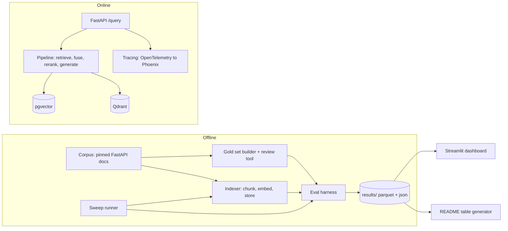

# RAGBench

A config-driven platform for benchmarking Retrieval-Augmented Generation (RAG) pipelines on a fixed, pinned corpus with a **human-verified gold question set**. It compares chunking strategies, embedding models, retrieval modes (dense, BM25, hybrid-RRF), rerankers, and two vector backends (pgvector and Qdrant), and reports retrieval quality, generation quality, latency and cost with confidence intervals.

> **Status: under construction (Phase 1 of 6).** The corpus pipeline and gold-set tooling are built and tested. The retrieval/eval/sweep/dashboard phases are not started. Every number below is generated from files in `results/`; where a stage has not run, it says so rather than guessing.

## Why this exists

RAG systems are usually tuned on vibes. This project makes the comparison honest:

- **Chunker-agnostic relevance labels.** Gold labels are spans in the *source document sections*, not in chunks. A retrieved chunk counts as a hit if its character span overlaps a gold span by a configurable minimum fraction — so chunking strategies are compared fairly.
- **A verified gold set, not raw LLM output.** Questions are generated by an LLM, then filtered (heading-copy, lexical-overlap, embedding dedup, answerability judge) and finally **reviewed by a human**. At least 150 questions must be human-verified before headline numbers are trusted.
- **Reproducibility first.** Pinned corpus commit, fixed seeds, pinned model revisions, recorded hardware. A stranger can rerun and get the same numbers within noise.

## Architecture



## Quickstart

```bash
# 1. Install (uv-managed, Python 3.13+)
make setup

# 2. Configure your LLM endpoint (any OpenAI-compatible API)
cp .env.example .env
# edit .env: LLM_BASE_URL, LLM_API_KEY, LLM_MODEL

# 3. Verify the endpoint answers
uv run ragbench llm-probe

# 4. Fetch the pinned corpus and build documents.jsonl
make ingest

# 5. Start the vector backends (pgvector + Qdrant)
make up
```

### LLM endpoint

All generation and judging go through one OpenAI-compatible client configured by env vars, so you can point it at Ollama, a private proxy, or a hosted API with no code changes:

| Variable | Meaning |
|---|---|
| `LLM_BASE_URL` | OpenAI-compatible base URL (e.g. `http://localhost:11434/v1`) |
| `LLM_API_KEY` | API key (use `ollama` for local Ollama) |
| `LLM_MODEL` | Model id to use for generation + judging |

See `.env.example` for the full list, including Postgres/Qdrant connection strings and the tracing toggle.

## Corpus

The corpus is the **FastAPI documentation** (English markdown under `docs/en/docs`), pinned to a specific release tag and commit SHA in [`corpus.lock`](corpus.lock). The license (MIT) is recorded there too, along with a SHA-256 of the fetched files so a rerun is verifiably the same corpus.

Relevance labels are defined at the **section** level. `ragbench corpus ingest` cleans the markdown, parses it into heading-delimited sections with character offsets, and writes `data/documents.jsonl`.

## Gold set

`ragbench goldset generate` samples sections (stratified by document and length), prompts the LLM for one question + reference answer per section, then applies quality filters:

- **Heading-copy** — drop questions that near-copy the heading.
- **Lexical-overlap** — drop near-verbatim section phrasing (would unfairly favor BM25).
- **Embedding dedup** — drop near-duplicate questions (cosine similarity over an ONNX MiniLM/BGE embedder, no torch required).
- **Answerability judge** — a judge model confirms the reference answer is supported by the section; failures are dropped.

Thresholds and per-stage drop counts are written to `data/goldset/generate_stats.json`. Survivors land in `data/goldset/candidates.jsonl`.

`ragbench goldset review` is a terminal tool (`a`ccept / `e`dit / `r`eject / `f`lag / `q`uit) that writes verified questions to `verified.jsonl`. Accepted questions are split into **dev (30%)** and **test (70%)**, stratified by question type and seeded.

## Commands

| Command | What it does |
|---|---|
| `make setup` | Install deps and pre-commit hooks |
| `make lint` | Ruff check + format check + mypy |
| `make test` | Unit tests |
| `make ingest` | Fetch pinned corpus, build `documents.jsonl` |
| `make goldset` | Generate filtered gold-set candidates |
| `make goldset-review` | Interactively review candidates |
| `make up` / `make down` | Start/stop pgvector + Qdrant |
| `make sweep` | Run the config sweep |
| `make report` | Generate the results report |
| `make reproduce` | Rerun the full pipeline end-to-end |

## Results

> **Not yet run.** The evaluation phases (indexing, retrieval, sweep, dashboard) have not started. This table is intentionally empty; it will be auto-generated from `results/` once runs exist.

## Hardware & environment

Recorded in [`results/hardware.json`](results/hardware.json) on every run: platform, CPU, RAM, GPU (if any), Python version, pinned package versions, and the resolved LLM model. Unit tests are CPU-only; no GPU is required for the embedding or reranking models used here.

## Limitations

- **Synthetic questions.** Questions are LLM-generated, then filtered and human-reviewed. They inherit the generator model's biases.
- **Judge-model bias.** Answerability is judged by an LLM; the judge model is recorded but its errors are not eliminated.
- **One corpus.** A single framework's documentation (FastAPI). Findings may not transfer to other domains.
- **One hardware profile.** Latency and cost numbers are tied to the machine in `results/hardware.json`.

See [`docs/LIMITATIONS.md`](docs/LIMITATIONS.md) for the full discussion.

## Project layout

```
ragbench/
├── corpus.lock              # pinned corpus: repo, tag, SHA, license, hash
├── configs/                 # pipeline + sweep definitions
├── src/ragbench/
│   ├── corpus/              # fetch, clean, section parsing
│   ├── goldset/             # generate, filters, review, split
│   ├── chunking/            # fixed, recursive_md, semantic
│   ├── embedding/           # embedders with disk cache
│   ├── stores/              # pgvector, qdrant
│   └── eval/                # harness, metrics
├── data/                    # gitignored: raw corpus, documents, gold set
├── results/                 # hardware.json, sweep outputs
└── docs/                    # spec, methodology, limitations, open questions
```

## Contributing

Issues and pull requests are welcome. Please run `make lint test` before opening a PR — CI enforces it.

## License

[MIT](LICENSE)
