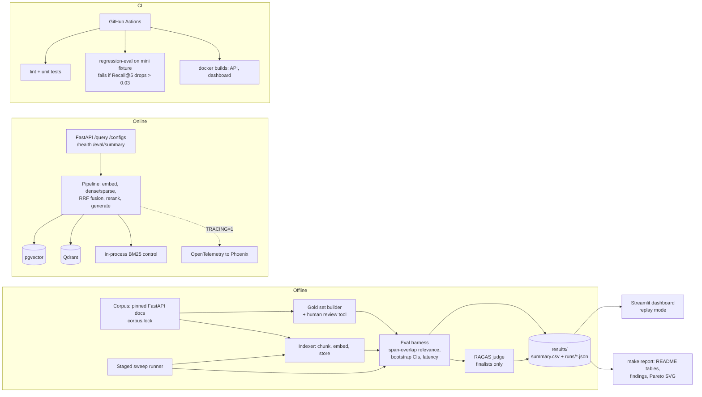

# Architecture

## Components

| Component | Code | Notes |
|---|---|---|
| Corpus fetch and parsing | `src/ragbench/corpus/` | Pinned tag + SHA-256 in `corpus.lock` |
| Gold set | `src/ragbench/goldset/` | Generate, filter, review, split; `data/goldset/verified.jsonl` |
| Chunkers | `src/ragbench/chunking/` | `fixed`, `recursive_md`, `semantic` (tiktoken token counts) |
| Embedders | `src/ragbench/embedding/` | sentence-transformers with a keyed disk cache for documents |
| Stores | `src/ragbench/stores/` | pgvector (HNSW + FTS), Qdrant (HNSW + BM25 sparse), in-process BM25 |
| Fusion and rerank | `src/ragbench/retrieval/`, `src/ragbench/rerank/` | RRF (k=60) in app code for every backend; `bge-reranker-base` |
| Pipeline | `src/ragbench/pipeline.py` | One namespace per `config_id`; per-stage timings and spans |
| Evaluation | `src/ragbench/eval/` | Metrics, bootstrap, latency, results schema, RAGAS, regression gate |
| Sweep | `src/ragbench/sweep/` | Staged grid A→D, dev selection, ablations, findings |
| API | `src/ragbench/api/` | FastAPI, LRU pipeline cache, indexes a config on first use if empty |
| Tracing | `src/ragbench/tracing/` | Off unless `TRACING=1`; zero overhead when off |
| Report | `src/ragbench/report/` | README marker blocks + `docs/figures/pareto.svg` |
| Dashboard | `dashboard/` | Reads `results/` only; no torch |

A `config_id` is the first 12 hex characters of the SHA-256 of the canonical config JSON,
so every result file and index namespace is tied to the exact config that produced it.
